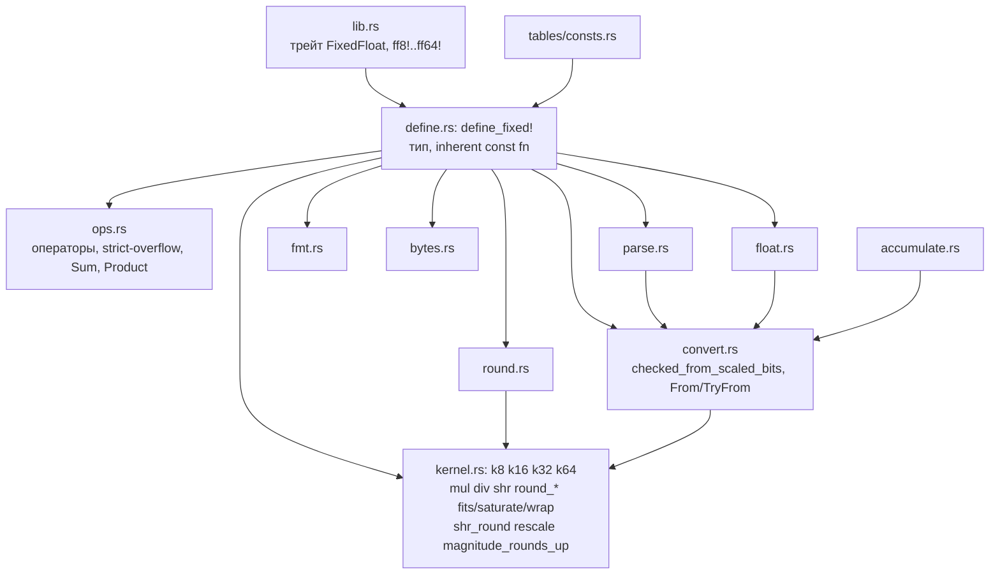

# fulcrum 0.2: как устроено внутри

Математика и устройство кода версии `0.2` (этапы 1–2, ширины 8–64 бита). Здесь — как это работает и почему это правильно. Формулы в LaTeX: блоки ```` ```math ```` и строчные `` $`…`$ ``, чтобы GitHub не применял к ним разметку Markdown.

Обозначения:
- $`W`$ — число битов хранения (8, 16, 32, 64), $`F = W/2`$ — число дробных битов.
- $`r`$ — сырое значение (`raw`), целое со знаком из $`[-2^{W-1},\ 2^{W-1}-1]`$.
- $`x = r / 2^F`$ — значение числа. Один ulp: $`\delta = 2^{-F}`$.
- $`\lfloor\cdot\rfloor`$, $`\lceil\cdot\rceil`$ — пол и потолок; $`\mathrm{trunc}`$ — округление к нулю.
- $`\mathrm{rnd}(t) = \lfloor t + \tfrac12 \rfloor`$ — **единое правило округления**: к ближайшему, середина к $`+\infty`$.

---

## 1. Представление

```math
x = \frac{r}{2^F},\qquad r \in \mathbb{Z},\qquad -2^{W-1} \le r \le 2^{W-1}-1.
```

| Тип | $`W`$ | $`F`$ | $`\min`$ | $`\max`$ | $`\delta`$ | Ядро | `Wide` |
|---|---|---|---|---|---|---|---|
| `FixedFloat8` | 8 | 4 | $`-8`$ | $`8 - 2^{-4}`$ | $`2^{-4}`$ | `k8` | `i16` |
| `FixedFloat16` | 16 | 8 | $`-128`$ | $`128 - 2^{-8}`$ | $`2^{-8}`$ | `k16` | `i32` |
| `FixedFloat32` | 32 | 16 | $`-2^{15}`$ | $`2^{15} - 2^{-16}`$ | $`2^{-16}`$ | `k32` | `i64` |
| `FixedFloat64` | 64 | 32 | $`-2^{31}`$ | $`2^{31} - 2^{-32}`$ | $`2^{-32}`$ | `k64` | `i128` |

Отображение $`r \mapsto x`$ — строго монотонная биекция, поэтому `Eq`, `Ord` и `Hash` — это просто `Eq`, `Ord` и `Hash` сырого целого (`#[derive]`). Нет `NaN`, `-0`, бесконечностей и денормалов: каждый битовый шаблон — ровно одно число и наоборот.

Разложение на части. Для любого $`r`$:

```math
r = 2^F \cdot \underbrace{\lfloor r / 2^F \rfloor}_{\texttt{int\_part}} + \underbrace{(r \bmod 2^F)}_{\texttt{frac\_part}},\qquad 0 \le r \bmod 2^F < 2^F.
```

`int_part` — арифметический сдвиг `r >> F` (округление к $`-\infty`$), `frac_part` — маска `r & (2^F - 1)`. Поэтому $`-1.25 = -2 + 0.75`$, и `from_parts(-2, 0.75 · 2^F)` восстанавливает $`-1.25`$.

---

## 2. Правило округления

### 2.1. Определение

Все операции, которые отбрасывают биты точного результата, кроме исключений ниже, возвращают

```math
\mathrm{rnd}(t) = \left\lfloor t + \tfrac12 \right\rfloor,
```

то есть ближайшее целое, а при равенстве — большее (середина к $`+\infty`$). Ошибка всегда $`|\mathrm{rnd}(t) - t| \le \tfrac12`$, в ulp результата.

Почему не «к чётному» и не «от нуля»: правило $`\lfloor t + \frac12 \rfloor`$ — одно сложение и один сдвиг без ветвлений и без знака, его проще всего доказывать (Kani, Lean), и оно одинаково для `*`, `/`, `>>`, `parse`, сужения и аккумуляторов. Исключения названы явно: `round` (от нуля, как `f64::round`), `round_ties_even` и `{:.N}` в `Display` (к чётному, как форматирование `f64`), `to_f64` (к чётному, приведением `as f64`, §8).

### 2.2. Сдвиг с округлением: `shr_round`

Для целого $`n`$ и $`s \ge 1`$ пусть $`n = q \cdot 2^s + \rho`$, $`0 \le \rho < 2^s`$. Тогда

```math
\mathrm{rnd}\left(\frac{n}{2^s}\right) = q + \left[\rho \ge 2^{s-1}\right] = (n \gg s) + \big((n \gg (s-1)) \mathbin{\&} 1\big).
```

Доказательство: $`n/2^s = q + \rho/2^s`$, где $`\rho/2^s \in [0, 1)`$; $`\lfloor q + \rho/2^s + \frac12 \rfloor = q + [\rho/2^s \ge \frac12]`$. Бит $`s-1`$ числа $`n`$ (в дополнительном коде, арифметический сдвиг) — старший бит $`\rho`$, то есть ровно $`[\rho \ge 2^{s-1}]`$. $`\square`$

Эта форма (`kernel::shr_round`) не переполняется ни при каком $`n`$: оба слагаемых получаются сдвигами, а их сумма по модулю не больше $`|n|/2^s + 1`$. Альтернативная форма $`(n + 2^{s-1}) \gg s`$ равна ей, но требует запаса в один бит; её используют ядра `k8`–`k32` в `mul`, где запас есть (§3.2), потому что она лучше векторизуется.

### 2.3. Та же формула на знаке и модуле

`parse` и `f64` работают со знаком и модулем $`m`$. Пусть отброшенная часть модуля — «первый бит» $`h`$ (половина) и «липкий» флаг $`s`$ (что-то ещё ненулевое). Для положительного числа $`\mathrm{rnd}`$ округляет модуль вверх при $`h`$; для отрицательного $`-m`$ равенство $`\mathrm{rnd}(-m) = -\lceil m - \frac12 \rceil`$ означает, что модуль округляется вверх только при $`h \wedge s`$ (строго больше половины):

```math
\texttt{magnitude\_rounds\_up}(\text{neg}, h, s) = h \wedge (\lnot\,\text{neg} \vee s).
```

### 2.4. Сужение: насыщение, проверка, заворачивание

Ядро возвращает точный (или правильно округлённый) результат $`w`$ в широком типе, а вызывающий код решает, что делать, если $`w`$ не помещается в $`[\min, \max]`$:

| Вариант | Результат |
|---|---|
| `checked_*` | $`w`$, если $`\min \le w \le \max`$, иначе `None` (`kernel::narrow`) |
| `saturating_*`, операторы | $`\mathrm{clamp}(w, \min, \max)`$ (`kernel::saturate`) |
| `wrapping_*` | $`w \bmod 2^W`$ в дополнительном коде (`kernel::wrap`, `as`-приведение) |
| `overflowing_*` | `(wrap(w), !fits(w))` |

Так одно ядро обслуживает все четыре семейства, и все они согласованы: `checked` — это `Some` ровно там, где `saturating` и `wrapping` совпадают с точным значением.

---

## 3. Ядро (`src/kernel.rs`)

### 3.1. Два вида промежуточных значений

1. **`Wide`** — следующий по размеру примитив (`i16` … `i128`). В нём ядро считает `mul`, `div`, `div_int`, `ceil`, `round_*`, `from_parts`. Только ядро приводит к `Wide` и обратно.
2. **`i128` с явным масштабом** $`(n, s)`$, значение $`n / 2^s`$. Его производят конверсии между ширинами, `parse`, `f64` и аккумуляторы; в тип он попадает через `checked_from_scaled_bits(n, s)` или `wrapping_from_scaled_bits(n, s)` (для `wrapping_from`); обе вызывают `kernel::rescale`.

### 3.2. Запас разрядности

$`W`$-битное хранение, $`F = W/2`$, `Wide` имеет $`2W = 4F`$ битов.

**Умножение.** $`|r_a|, |r_b| \le 2^{W-1}`$, поэтому $`|r_a r_b| \le 2^{2W-2}`$, и $`r_a r_b + 2^{F-1}`$ помещается в $`2W-1`$ бит со знаком. Переполнения нет.

**Деление.** Числитель $`|r_a| \cdot 2^F \le 2^{W-1+F}`$; ядро строит $`2|n| + |d| \le 2^{W+F} + 2^{W-1} < 2^{3F+1}`$, что меньше $`2^{4F-1}`$. Переполнения нет.

### 3.3. Умножение

```math
x_a x_b = \frac{r_a r_b}{2^{2F}} \quad\Longrightarrow\quad r_{a\cdot b} = \mathrm{rnd}\left(\frac{r_a r_b}{2^F}\right).
```

- `k8`, `k16`, `k32`: `(p + HALF) >> F`, где $`p = r_a r_b`$ в `Wide`, $`\text{HALF} = 2^{F-1}`$ (форма §2.2 с прибавлением, лучше векторизуется).
- `k64`: $`p`$ — `i128`, используется форма `(p >> F) + ((p >> (F-1)) & 1)`. Обе формы равны (§2.2), но здесь перенос от $`+\text{HALF}`$ через 128-битное сложение стоял бы на критическом пути, а так старшее слово получается одним сдвигом.

Затем `saturate` / `narrow` / `wrap` (§2.4). Ошибка до сужения $`\le \frac12\delta`$.

`mul_int(n)` — точное `r · n` в хранимом типе с насыщением, без округления.

### 3.4. Деление

```math
\frac{x_a}{x_b} = \frac{r_a}{r_b} \quad\Longrightarrow\quad r_{a/b} = \mathrm{rnd}\left(\frac{r_a \cdot 2^F}{r_b}\right).
```

Нужно $`\mathrm{rnd}(n/d)`$ для целых $`n, d`$, $`d \ne 0`$, одним аппаратным делением, которое в Rust усекает к нулю. Две равносильные формы.

Обозначим $`\nu = [\,n/d < 0\,]`$ — знак результата (1, если знаки $`n`$ и $`d`$ различны и $`n \neq 0`$).

**Лемма.** Для $`u \ge 0`$, $`v > 0`$:

```math
\mathrm{rnd}\left(\frac{u}{v}\right) = \left\lfloor \frac{2u + v}{2v} \right\rfloor,
\qquad
\mathrm{rnd}\left(-\frac{u}{v}\right) = -\left\lfloor \frac{2u + v - 1}{2v} \right\rfloor.
```

Доказательство. Первое: $`\lfloor u/v + \frac12 \rfloor = \lfloor (2u + v) / 2v \rfloor`$. Второе: $`\mathrm{rnd}(-t) = \lfloor -t + \frac12 \rfloor = -\lceil t - \frac12 \rceil`$, и для целых $`\lceil a/b \rceil = \lfloor (a + b - 1)/b \rfloor`$ при $`b > 0`$, с $`a = 2u - v`$, $`b = 2v`$: $`\lceil (2u - v)/2v \rceil = \lfloor (2u + v - 1)/2v \rfloor`$. $`\square`$

Обе формулы объединяются в

```math
\mathrm{rnd}\left(\frac{n}{d}\right) = \mathrm{sign}(n/d) \cdot \left\lfloor \frac{2|n| + |d| - \nu}{2|d|} \right\rfloor.
```

**Форма `magnitude`** (`k8`, `k64`): беззнаковое деление модулей ровно по этой формуле, знак ставится после. Модули берутся на ширине хранения до расширения: у `k64` это `u128`-деление, у которого нет второго взятия модуля внутри `__divti3`.

**Форма `signed`** (`k16`, `k32`): одно знаковое усекающее деление

```math
q = \mathrm{trunc}\left(\frac{2n + b}{2d}\right),\qquad
b = \begin{cases} |d| - [d<0], & n \ge 0,\\ -\big(|d| - 1 + [d<0]\big), & n < 0. \end{cases}
```

Проверка: при $`n \ge 0`$ имеем $`\nu = [d < 0]`$, и $`b = |d| - \nu \ge 0`$; при $`n < 0`$ имеем $`\nu = [d > 0] = 1 - [d<0]`$, и $`b = -(|d| - \nu) \le 0`$. Значит, $`b`$ имеет знак $`n`$ и $`|b| = |d| - \nu`$, числитель $`2n + b`$ имеет знак $`n`$ и модуль $`2|n| + |d| - \nu`$, а усекающее деление на $`2d`$ даёт $`\mathrm{sign}(n)\mathrm{sign}(d) \cdot \lfloor (2|n| + |d| - \nu)/2|d| \rfloor`$ — ровно формулу выше. $`\square`$ Знак после деления обрабатывать не нужно; у `k16` и `k32` это лучше векторизуется.

**Деление на ноль.** `div_total` вызывается при любом делителе и при $`b = 0`$ возвращает неопределённое значение: в `k16` делит на `b | (b == 0)` без ветвления, чтобы цикл векторизовался без предиката, в остальных ядрах возвращает $`0`$. Тип отбрасывает это значение и возвращает $`\max`$, $`\min`$ или $`0`$ по знаку делимого — значение, к которому стремится насыщающее деление при $`|x_b| \to 0`$.

`div_int(n)` — та же формула без сдвига числителя: $`\mathrm{rnd}(r_a / n)`$.

### 3.5. Сдвиги

```math
x \ll k = x \cdot 2^k:\quad r \mapsto r \cdot 2^k \text{ (точно, переполнение — если } (r \ll k) \gg k \ne r\text{)};
\qquad
x \gg k:\quad r \mapsto \mathrm{rnd}(r / 2^k).
```

`>>` — это `shr_round` на хранимом типе, а не арифметический сдвиг, поэтому `x >> 1 == x / 2` для любого `x` (оба равны $`\mathrm{rnd}(r/2)`$). При $`k \ge W`$: `<<` даёт $`0`$ или насыщение, `>>` даёт $`0`$ (для $`r = -1`$: $`\mathrm{rnd}(-2^{-k}) = 0`$).

### 3.6. Середина

```math
\texttt{midpoint}(a, b) = (a \mathbin{|} b) - \big((a \oplus b) \gg 1\big) = \left\lceil \frac{a+b}{2} \right\rceil = \mathrm{rnd}\left(\frac{a+b}{2}\right).
```

Доказательство: $`a + b = 2(a \mathbin{\&} b) + (a \oplus b)`$ и $`a \mathbin{|} b = (a \mathbin{\&} b) + (a \oplus b)`$. Тогда

```math
(a \mathbin{|} b) - \left\lfloor \frac{a \oplus b}{2} \right\rfloor = (a \mathbin{\&} b) + \left\lceil \frac{a \oplus b}{2} \right\rceil = \left\lceil \frac{a+b}{2} \right\rceil.
```

Для целого $`t`$: $`\lceil t/2 \rceil = \lfloor t/2 + \frac12 \rfloor = \mathrm{rnd}(t/2)`$. Все промежуточные значения лежат между $`a`$ и $`b`$ по модулю, переполнения нет. $`\square`$

### 3.7. Округление к целому

Пусть $`M = 2^F - 1`$ (маска дробной части), $`H = 2^{F-1}`$.

| Функция | Формула на сыром | Значение |
|---|---|---|
| `floor` | $`r \mathbin{\&} \lnot M`$ | $`2^F \lfloor r/2^F \rfloor`$ |
| `ceil` | $`(r + M) \mathbin{\&} \lnot M`$ (в `Wide`) | $`2^F \lceil r/2^F \rceil`$ |
| `trunc` | `floor` при $`r \ge 0`$; $`(r + M) \mathbin{\&} \lnot M`$ при $`r < 0`$ | к нулю |
| `fract` | $`r - \mathrm{trunc}(r)`$ | со знаком $`x`$ |
| `round` | $`r \ge 0`$: $`(r + H) \mathbin{\&} \lnot M`$; $`r < 0`$: $`-\big((H - r) \mathbin{\&} \lnot M\big)`$ | к ближайшему, середина от нуля |
| `round_ties_even` | $`\lfloor\cdot\rfloor`$, $`+2^F`$ при $`f > H`$ или ($`f = H`$ и целая часть нечётна) | к ближайшему, к чётному |

`ceil` и `round*` считаются в `Wide`, потому что $`\lceil \max \rceil = 2^{W-1-F} \cdot 2^F`$ не помещается в хранимый тип; потом насыщение или `None`. `trunc` при $`r < 0`$ не переполняется: $`r + M < M`$. `to_int_*` — те же значения, делённые на $`2^F`$; целое хранимого типа шире целой части на $`F`$ бит, поэтому они не переполняются никогда.

### 3.8. Перемасштабирование: `rescale`

Значение $`n / 2^s`$ (i128 с масштабом) переводится к $`F`$ дробным битам:

```math
\texttt{rescale}(n, s, F) = \begin{cases}
\mathrm{rnd}(n / 2^{s-F}) & s \ge F \text{ (отбрасываем биты)},\\
n \cdot 2^{F-s} & s < F \text{ (точно; флаг, если вышли за i128)}.
\end{cases}
```

Затем проверка диапазона. Через `rescale` идут: целые ($`s = 0`$), сужение и расширение между ширинами ($`s = F_{\text{src}}`$), `parse` и `f64` (по знаку и модулю, §6, §8), `finish` аккумуляторов ($`s = S`$, §5). Поэтому правило округления у всех них одно, и сужение $`F_{\text{src}} > F_{\text{dst}}`$ — это $`\mathrm{rnd}(r / 2^{F_{\text{src}} - F_{\text{dst}}})`$.

`wrapping_from` использует тот же `rescale` и берёт младшие $`W`$ бит результата.

---

### 3.9. Три операнда: `mul_add`, `mul_div`, `lerp`

Каждая из трёх функций вычисляет точное значение в широком типе и округляет его один раз:

```math
\texttt{mul\_add}(a, b, c) = \mathrm{rnd}\left(\frac{r_a r_b + r_c 2^F}{2^F}\right),
\qquad
\texttt{mul\_div}(a, b, c) = \mathrm{rnd}\left(\frac{r_a r_b}{r_c}\right),
\qquad
\texttt{lerp}(a, b, t) = r_a + \mathrm{rnd}\left(\frac{(r_b - r_a) r_t}{2^F}\right).
```

Для `mul_div` масштабы сокращаются: $`\frac{(r_a/2^F)(r_b/2^F)}{r_c/2^F} = \frac{r_a r_b}{r_c} \cdot 2^{-F}`$. Для `lerp` $`r_a`$ целое и выносится из округления: $`\mathrm{rnd}(r_a + y) = r_a + \mathrm{rnd}(y)`$. Поэтому `lerp` при $`t = 0`$ даёт ровно $`a`$, а при $`t = 1`$ ровно $`b`$.

Запас при хранении $`W = 2F`$ бит и широком типе $`2W`$ бит:

- `mul_add`: $`r_c 2^F`$ кратно $`2^F`$ и не меняет отброшенные биты произведения, поэтому $`\mathrm{rnd}((r_a r_b + r_c 2^F)/2^F) = \mathrm{rnd}(r_a r_b / 2^F) + r_c`$. Ядро так и считает: `mul(a, b) + c` в широком типе, без отдельного сдвига. Сумма помещается: $`|\texttt{mul}(a, b)| \le 2^{3F-2}`$ и $`|r_c| \le 2^{2F-1}`$ при $`W = 2F`$, а широкий тип — $`4F`$ бит.
- `mul_div`: деление модулей, как у `div` (§3.4): $`2|r_a r_b| + |r_c| \le 2^{2W-1} + 2^{W-1} < 2^{2W}`$ в беззнаковом широком типе. Модули берутся у сомножителей на ширине хранения и перемножаются без знака, а знак результата — исключающее «или» трёх знаков. Это то же значение, что и модуль знакового произведения, но у `k64` вдвое быстрее: `i128::unsigned_abs` произведения перед делением стоил столько же, сколько само деление.
- `lerp`: $`|r_b - r_a| \le 2^W - 1`$ и $`|r_t| \le 2^{W-1}`$, произведение не больше $`2^{2W-1} - 2^{W-1}`$.

У `FixedFloat64` широкий тип — `i128`/`u128`, и все три оценки укладываются в него. 256-битная арифметика нужна только состоянию `Accumulator64` (§5).

## 4. Алгебраические свойства

| Операция | Коммутативна | Ассоциативна |
|---|---|---|
| `+` с насыщением | да | только если ни одна частичная сумма не насыщается (или все слагаемые одного знака: тогда обе стороны $`= \mathrm{clamp}(a+b+c)`$) |
| `wrapping_add` | да | да, в $`\mathbb{Z}/2^W`$ |
| аккумулятор `add`/`merge` | да | да, в $`\mathbb{Z}/2^{128}`$ |
| `*` | да | нет |
| `min`, `max` | да | да |

Неассоциативность `*`. В Q4.4: $`(\tfrac12 \cdot \tfrac12) \cdot \delta = \tfrac14 \cdot \delta = \mathrm{rnd}(\tfrac14)\delta = 0`$, а $`\tfrac12 \cdot (\tfrac12 \cdot \delta) = \tfrac12 \cdot \mathrm{rnd}(\tfrac12)\delta = \tfrac12 \cdot \delta = \delta`$.

Граница расхождения (без насыщения). Пусть $`\varepsilon_1, \varepsilon_2 \in [-\frac12, \frac12]`$ — ошибки округления в ulp. Тогда

```math
(ab)c = abc + \varepsilon_1 c + \varepsilon_2,\qquad a(bc) = abc + \varepsilon_1' a + \varepsilon_2',
```

откуда $`|(ab)c - a(bc)| \le \frac12(|a| + |c|) + 1`$ ulp, а с учётом целочисленности результата — $`\le \lfloor \frac12(|a| + |c|) \rfloor + 1`$; граница достигается. Если $`b`$ и $`c`$ целые, $`bc`$ точно, и $`(ab)c = a(bc)`$ бит в бит. Всё это проверяет `tests/algebra.rs`.

Следствие для движка: свёртки — только через аккумуляторы (§5), произведения — в фиксированном порядке.

---

## 5. Аккумуляторы (`src/accumulate.rs`)

Состояние — целое $`\Sigma`$ с масштабом $`S`$: значение $`\Sigma / 2^S`$. Для 8–32 бит это `i128`, для 64 бит — 256-битное целое.

| Аккумулятор | $`F`$ | $`S`$ | `add(x)` | `add_product(a, b)` |
|---|---|---|---|---|
| `Accumulator8` | 4 | 8 | $`\Sigma \mathrel{+}= r \cdot 2^{4}`$ | $`\Sigma \mathrel{+}= r_a r_b`$ |
| `Accumulator16` | 8 | 16 | $`\Sigma \mathrel{+}= r \cdot 2^{8}`$ | $`\Sigma \mathrel{+}= r_a r_b`$ |
| `Accumulator32` | 16 | 32 | $`\Sigma \mathrel{+}= r \cdot 2^{16}`$ | $`\Sigma \mathrel{+}= r_a r_b`$ |
| `Accumulator64` | 32 | 64 | $`\Sigma \mathrel{+}= r \cdot 2^{32}`$ | $`\Sigma \mathrel{+}= r_a r_b`$ |

Везде $`S = 2F`$: произведение $`r_a r_b`$ имеет масштаб $`2^{2F}`$ и складывается **без округления**. У `Accumulator64` одно произведение доходит до $`2^{126}`$, так что `i128` переполняется уже на четырёх. Поэтому состояние `Accumulator64` — внутренний 256-битный `I256` (`src/wide.rs`): два слова `u128` и `i128` со сложением с переносом. `finish` точно сдвигает его на $`S - F - 1 = 31`$ бит, ограничивает диапазоном `i128` и округляет последний бит через `kernel::shr_round(·, 1)`: $`\lfloor \lfloor \Sigma/2^{31} \rfloor / 2 \rfloor`$ плюс младший бит равно $`\lfloor \Sigma / 2^{32} \rfloor`$ плюс первый отброшенный бит. Затем результат сужается как обычно, через `saturating_from_scaled_bits`. Ограниченное значение вне диапазона любого типа и после сдвига остаётся вне его.

**Почему результат не зависит от порядка.** Сложение в `i128` с заворачиванием — это сложение в кольце $`\mathbb{Z}/2^{128}`$, оно ассоциативно и коммутативно. Значит, любой порядок `add` и любое дерево `merge` дают одно и то же $`\Sigma \bmod 2^{128}`$. Если истинная сумма $`\sum_i t_i`$ лежит в $`[-2^{127}, 2^{127})`$, то $`\Sigma`$ ей равна, даже если промежуточные суммы заворачивались: вычет по модулю $`2^{128}`$ однозначно определяет число из этого интервала.

Запас. Слагаемое по модулю не больше $`2^{W-1} \cdot 2^{S-F} = 2^{S+F-1}`$ (для `add`) или $`2^{2W-2}`$ (для `add_product`). Для `Accumulator32`: $`2^{47}`$ и $`2^{62}`$, то есть ошибки нет до $`2^{65}`$ произведений; для `Accumulator64` в 256 битах: $`2^{95}`$ и $`2^{126}`$, до $`2^{129}`$ произведений. Отсюда консервативное «больше $`2^{63}`$ слагаемых» в документации.

**`finish`** $`= \mathrm{clamp}\big(\mathrm{rnd}(\Sigma / 2^{S-F})\big)`$ — одно округление и одно насыщение на всю свёртку (`saturating_from_scaled_bits(round(Σ, F), F)`, §3.8; `round` — операция состояния, у `Accumulator64` — через `I256` выше). `Iterator::sum` — это аккумулятор и `finish`.

**Скалярное произведение.** Через `*` и `+`: $`n`$ округлений, ошибка до $`\frac n2`$ ulp и зависимость от порядка. Через `add_product`: точная сумма $`\sum r_{a_i} r_{b_i}`$ и одно округление, ошибка $`\le \frac12`$ ulp.

---

## 6. Разбор строк (`src/parse.rs`)

Вход: $`\pm\, I.d_1 d_2 \dots d_k`$. Надо получить $`\mathrm{rnd}(2^F \cdot |x|)`$ с учётом знака по §2.3, точно, для строки любой длины.

**Целая часть** $`I`$ накапливается в `u128`; как только $`I > 2^{63}`$, ставится флаг переполнения (ни один тип 0.1 не вмещает $`|x| > 2^{31}`$, так что числа после флага не важны).

**Дробная часть** $`\varphi = 0.d_1 d_2 \dots`$ переводится в двоичную удвоением. Если $`\varphi \in [0, 1)`$, то $`2\varphi = c + \varphi'`$, $`c = \lfloor 2\varphi \rfloor \in \{0, 1\}`$ — следующий двоичный разряд. Удвоение десятичной записи — сложение с переносом справа налево (`double`): цифры остаются $`\le 9`$, перенос из первой цифры — это $`c`$. После $`F + 1`$ удвоений получаем

```math
\varphi = \frac{B}{2^{F+1}} + \frac{\varphi_{\text{rest}}}{2^{F+1}},\qquad 0 \le B < 2^{F+1},\ \ 0 \le \varphi_{\text{rest}} < 1.
```

Младший бит $`B`$ — «половина» $`h`$, а $`\varphi_{\text{rest}} \ne 0`$ — «липкий» флаг. Модуль результата:

```math
m = I \cdot 2^F + \lfloor B/2 \rfloor + \texttt{magnitude\_rounds\_up}(\text{neg}, h, \text{sticky}).
```

**Почему хватает $`F+1`$ десятичных цифр.** Правило округления зависит только от того, в каком интервале $`\big[\frac{j}{2^{F+1}}, \frac{j+1}{2^{F+1}}\big)`$ лежит $`\varphi`$ и равна ли $`\varphi`$ его левому концу. Все концы — кратные $`2^{-(F+1)} = 5^{F+1} \cdot 10^{-(F+1)}`$, то есть кратные $`10^{-(F+1)}`$. Пусть $`\tau`$ — запись $`\varphi`$, обрезанная до $`F+1`$ цифр. Тогда $`\tau \le \varphi < \tau + 10^{-(F+1)}`$, и между двумя соседними кратными $`10^{-(F+1)}`$ нет других концов интервалов. Значит, $`\tau`$ и $`\varphi`$ лежат в одном интервале, а отличаются только тем, есть ли ненулевой остаток, — это и есть `sticky` для отброшенных цифр. $`\square`$

Поэтому память фиксирована ($`F + 1 \le 65`$ цифр), а результат точен при любой длине строки. Kani доказывает отсутствие паники на строках до 64 байт; `fuzz/parse` и `exhaustive` сравнивают результат с рациональным оракулом и с `parse ∘ Display`.

Литералы `ff*!` вызывают тот же `const fn` в константном контексте (с `_` и внешним `-`); паника в `const` — это ошибка компиляции.

---

## 7. Вывод (`src/fmt.rs`)

**Точность без `{:.N}`.** Дробная часть — $`f / 2^F`$, $`0 \le f < 2^F`$. Цифры получаются умножением на 10: $`10f = 2^F d + f'`$, $`d`$ — очередная цифра. Поскольку

```math
\frac{f}{2^F} = \frac{f \cdot 5^F}{10^F},
```

десятичная запись конечна и имеет не больше $`F`$ цифр; цикл останавливается, когда $`f' = 0`$. Вывод точный: `parse(display(x)) == x` для всех $`x`$ (для `FixedFloat32` проверено перебором всех $`2^{32}`$ значений).

**С `{:.N}`.** Берутся $`\min(N, F)`$ цифр. Если $`N \ge F`$, остаток дополняется нулями, округления нет. Иначе остаток $`f'`$ сравнивается с $`2^{F-1}`$: больше — вверх; равно — вверх, если последняя цифра нечётная (к чётному, как у `f64`); перенос идёт через девятки и при необходимости в целую часть. Затем знак, ширина, заполнитель, выравнивание, `+`, `0`.

**`Debug`**: `Display`, затем сырые биты в hex фиксированной ширины ($`2 \cdot`$ байты цифр).

---

## 8. Конверсии с `f64` (`src/float.rs`, фича `float-convert`)

Только целочисленная работа с битами IEEE 754; ни одной операции с плавающей точкой, кроме точного приведения целого.

**Из `f64`.** $`x = (-1)^\sigma \cdot m \cdot 2^e`$, где $`m`$ — мантисса со скрытой единицей ($`m < 2^{53}`$), $`e`$ — несмещённый показатель (для денормалов $`e = -1074`$). Нужен $`\mathrm{rnd}(m \cdot 2^{e+F})`$. Пусть $`s = e + F`$:
- $`s \ge 0`$: модуль $`m \cdot 2^s`$ точный; при $`s \ge 75`$ заведомо вне любого диапазона;
- $`s < 0`$: $`q = m \gg (-s)`$, отброшенное $`\rho`$ даёт $`h = [\rho \ge 2^{-s-1}]`$ и $`\text{sticky} = [\rho \bmod 2^{-s-1} \ne 0]`$; при $`-s > 64`$ модуль округляется к нулю.

Дальше `magnitude_rounds_up` (§2.3) и проверка диапазона. `NaN` → `None` (или $`0`$ в `saturating_`), $`\pm\infty`$ → `None` (или насыщение).

**В `f64`.** $`r`$ приводится к `f64` (правильное округление IEEE, к чётному; точно при $`\le 53`$ значащих битах), затем из поля показателя вычитается $`F`$: это точное умножение на $`2^{-F}`$, потому что $`|r| \ge 1`$ и результат остаётся нормальным числом ($`F \le 32`$).

---

## 9. Константы (`tools/gen-tables`)

Каждая константа $`c`$ считается в интервальной арифметике с фиксированной точкой $`P = 384`$ бита: пара целых $`[\ell, u]`$ с гарантией $`\ell \le c \cdot 2^P \le u`$. Сложение и вычитание складывают концы; деление округляет нижний конец вниз, верхний вверх; ряды прибавляют к ширине интервала оценку ошибки отбрасывания.

Константа выдаётся для типа с $`F`$ дробными битами, только если

```math
\mathrm{rnd}\left(\frac{\ell}{2^{P-F}}\right) = \mathrm{rnd}\left(\frac{u}{2^{P-F}}\right),
```

иначе генератор падает («precision too low»). Тогда выданное значение — правильно округлённое $`c`$ (по тому же правилу §2.1). Константа пропускается, если она вне диапазона типа или округляется в $`0`$.

Формулы:

```math
\pi = 16\arctan\tfrac15 - 4\arctan\tfrac1{239}\ \ \text{(Мэчин)},\qquad
e = \sum_{k \ge 0} \frac{1}{k!},
```

```math
\ln 2 = 2\mathrm{artanh}\,\tfrac13,\qquad
\ln 10 = 3\ln 2 + 2\mathrm{artanh}\,\tfrac19\ \ \left(\tfrac{1 + 1/9}{1 - 1/9} = \tfrac54\right),\qquad
\sqrt n = \big\lfloor \sqrt{n \cdot 2^{2P}} \big\rfloor / 2^P,
```

остальные — через деление и умножение интервалов (`FRAC_PI_k`, `FRAC_1_SQRT_n`, $`\log_2 e = 1/\ln 2`$, $`\varphi = (1 + \sqrt5)/2`$, `DEG_TO_RAD` $`= \pi/180`$, …). CI перегенерирует `src/tables/consts.rs` и падает на любом diff.

---

## 10. Как код собран из частей



- `define_fixed!` генерирует тип по параметрам `bits`, `ubits`, `int`, `frac`, `frac_bits`, `bytes`, `kernel`, списки `From`/`TryFrom`; всё, что не зависит от ширины, написано один раз в `impl_*!` соседних модулей.
- Ядро написано в подмножестве Rust, которое понимает Aeneas (свободные функции над примитивами, без трейтов и замыканий), — для Lean-доказательств ядра на последнем этапе плана (L1–L3, ROADMAP).
- Никаких `asm!`, `target_arch`, `target_pointer_width`, `target_endian` и `f32`/`f64` вне `float.rs` (проверяет `tests/source_rules.rs` и clippy `float_arithmetic = "deny"`); `unsafe` запрещён `#![forbid(unsafe_code)]`. `usize` есть только в `parse` и `fmt`: счётчики и индексы цифр, ширина и точность из `core::fmt`; на значения он не влияет. Отсюда детерминизм: результат — функция только входных битов.

---

## 11. Что и чем проверено

| Утверждение | Где доказано или проверено |
|---|---|
| эталон `tests/common/reference.rs` (округление, насыщение, деление на ноль, `rescale`, `mul`, `div`, `mul_add`, `mul_div`, `lerp`) | оракул на рациональных числах (`oracle/tests/reference.rs`) в пределах области определения каждой функции; дальше этот же файл — эталон тестов и Kani-проверок |
| `>>` и сужение $`= \mathrm{rnd}(n/2^s)`$ | Kani против эталона, все ширины |
| `mul` $`= \mathrm{rnd}(r_a r_b / 2^F)`$ | Kani на 8–32 битах; перебор пар 8, 16 бит; оракул и стресс на 32, 64 |
| `div`, `div_int`, `from_ratio` $`= \mathrm{rnd}(n/d)`$ (лемма §3.4) | Kani на 8 битах; перебор пар 8, 16 бит; оракул, фаззинг, стресс |
| `+ - neg abs`, `midpoint`, округления, `to_int_*`, сдвиги, части, байты, сужение, `from_int` | Kani на всех четырёх ширинах против спецификации |
| `parse` не паникует | Kani, строки до 64 байт, все ширины (через контракты `double` и `fraction_bits`) |
| `parse(display(x)) = x` | перебор всех $`2^{32}`$ значений `FixedFloat32` (еженедельно) |
| порядок слагаемых не влияет на аккумулятор | Kani на 8 битах; `tests/accumulate.rs` |
| `mul_add`, `mul_div`, `lerp` по §3.9 | Kani на 8 битах, включая `mul_div` на ноль (`mul_add` и `lerp` ещё на 16); перебор всех троек 8 бит и случайные тройки 16–64 (`tests/combined.rs`); оракул на всех ширинах; фаззинг против оракула, включая флаг `checked_*` |
| `I256` и `Accumulator64::add_product` | Kani: сложение, вычитание и сдвиг на полных 256-битных операндах и против `i128`, одно произведение против независимого округления; все $`2^{24}`$ пар «произведение + значение» на 8 битах; оракул для скалярного произведения на всех ширинах |
| свойства §4 | `tests/algebra.rs`: все $`2^{24}`$ тройки для 8 бит, случайные для 16–64 |
| детерминизм между платформами | golden hash: $`4 \times 250\,000`$ раундов операций, FNV-хеш байтов, одна константа на x86-64, ARM64, i686 в debug и release |
| `*`, `/`, `mul_add`, `mul_div`, `lerp` для `FixedFloat64` не паникуют | Kani: `mul_no_panic_64`, `div_no_panic_64` (полный перебор символьных 64-битных операндов, меньше 30 с каждый) |

Lean (`verify/lean`) пока содержит только определение спецификации `Fixed n` ($`x = \text{raw}/2^n`$); теоремы L1–L3 о ядре — последний этап плана (ROADMAP).
